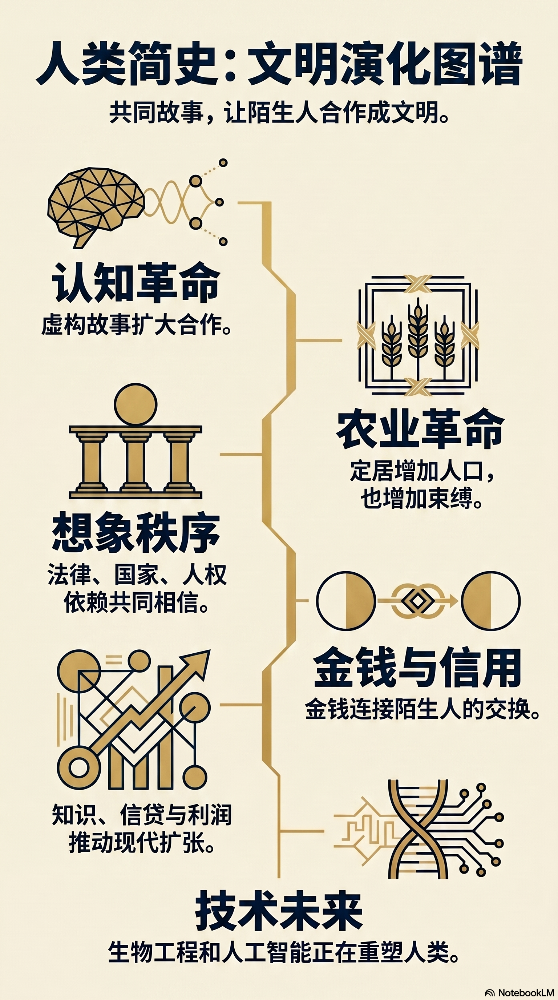
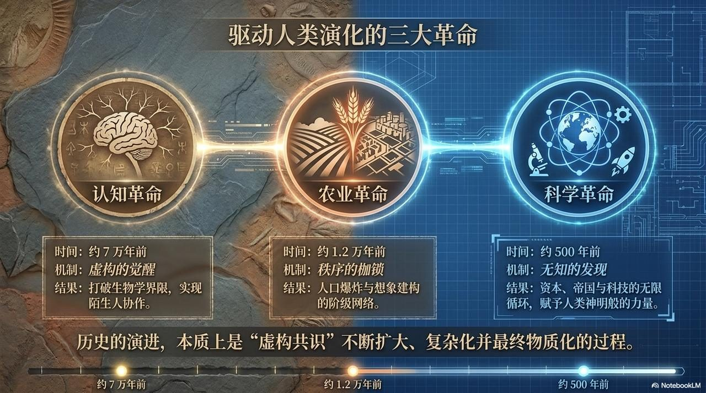
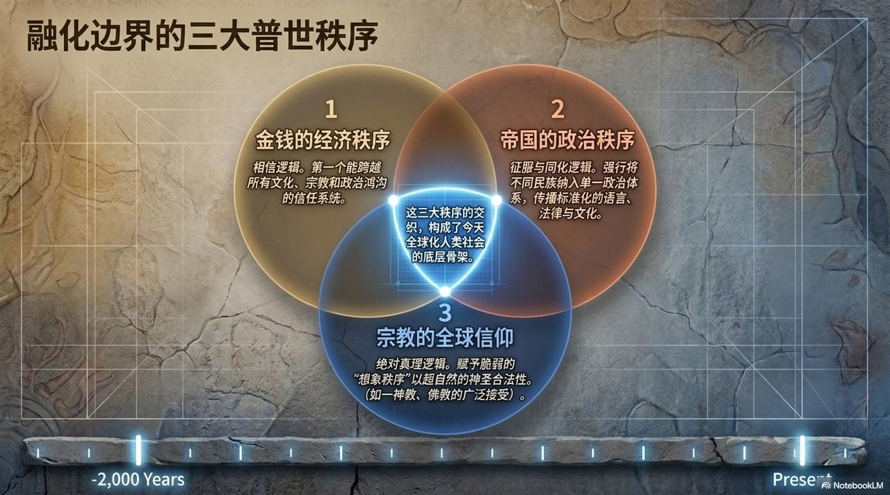
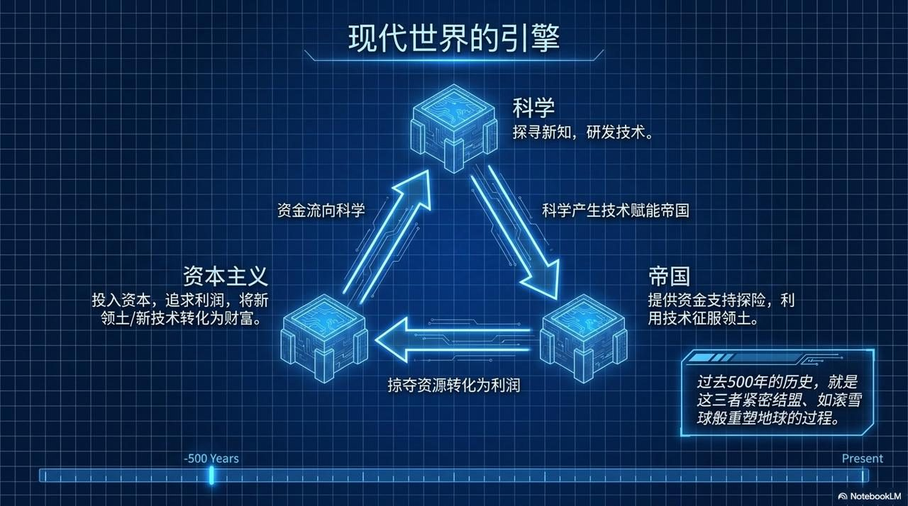

# NotebookLM Workflow

English | [简体中文](./README.zh-CN.md)

Modular Google NotebookLM automation skills, prompt libraries, and reference demos for Hermes/Codex-style AI agents.

## Overview

Instead of a single monolithic script, this repository organizes NotebookLM automation as a layered stack of 9 skills (5 top-level skills plus 4 specialized sub-skills under [`skills/notebooklm/`](./skills/notebooklm/SKILL.md)). Agents route requests across source preparation, NotebookLM CLI/API operations, source-grounded book-to-deck extraction, Studio prompt engineering, quality checks, and Google Drive delivery.

## Included Skills

| Layer | Skill | Responsibility |
|---|---|---|
| Core CLI / API | [`skills/notebooklm/`](./skills/notebooklm/SKILL.md) | Authenticate (`notebooklm-py==0.3.4`), manage profiles, create/list notebooks, upload sources, wait for indexing, generate and download Studio artifacts, and verify auth health. Includes [`SECURITY_AUDIT.md`](./skills/notebooklm/SECURITY_AUDIT.md) and [`import_browser_cookies.py`](./skills/notebooklm/import_browser_cookies.py). |
| Book-to-PPT Pipeline | [`skills/notebooklm/notebooklm-book-ppt-workflow/`](./skills/notebooklm/notebooklm-book-ppt-workflow/SKILL.md) | Extracts book structure, core ideas, cases, timelines, characters, concepts, quotes, and misreadings strictly from NotebookLM sources, fact-checks the script, and audits the deck before delivery. |
| Studio Prompts | [`skills/notebooklm/notebooklm-studio-quality-prompts/`](./skills/notebooklm/notebooklm-studio-quality-prompts/SKILL.md) | Artifact-specific prompts for slide decks (concise vs. detailed), study guides, mind maps, infographics, data tables, quizzes, flashcards, audio, and video. |
| Rich Slide Decks | [`skills/notebooklm/notebooklm-rich-slide-decks/`](./skills/notebooklm/notebooklm-rich-slide-decks/SKILL.md) | Density targets (`10-14` slides concise vs. `18-24` slides detailed), layout variety rules, and `.pptx` archive/visual QA alongside external PowerPoint tooling / `python-pptx`. |
| Drive Delivery | [`skills/notebooklm/notebooklm-artifacts-to-drive/`](./skills/notebooklm/notebooklm-artifacts-to-drive/SKILL.md) | Uploads full-quality originals to Google Drive under `NotebookLM/<notebook name>/` via `gws`, generates share links, and keeps large binaries out of git. |
| Blog Import | [`skills/blog-2-notebooklm/`](./skills/blog-2-notebooklm/SKILL.md) | Crawls sitemaps (`collect_sitemap_urls.py`) or topic pages, uploads each article URL as a separate source, splits across continuation notebooks if needed, and prefixes titles with `YYYY-MM-DD`. |
| Batch Book Upload | [`skills/upload-books-to-notebooklm/`](./skills/upload-books-to-notebooklm/SKILL.md) | Scans local `.pdf`/`.txt`/`.md`/`.docx` files (`upload_books_to_notebooklm.py`), normalizes titles, groups multi-volume series into single notebooks, and verifies `ready` status. |
| EPUB Conversion | [`skills/epub-2-pdf/`](./skills/epub-2-pdf/SKILL.md) | Builds Calibre `ebook-convert` commands (`build_ebook_convert_cmd.py`) with controllable TOC depth (`source`/`visible`/`detailed`/`medium`/`concise`), A4 layout, page numbers, and CJK serif fonts. |
| Authorized Book CLI | [`skills/zlibrary-cli/`](./skills/zlibrary-cli/SKILL.md) | Setup and troubleshooting for `heartleo/zlib`, including [`noninteractive_download.go`](./skills/zlibrary-cli/scripts/noninteractive_download.go) for non-TTY agents and explicit session switching via [`zlib_account.py`](./skills/zlibrary-cli/scripts/zlib_account.py). |

### Typical Routing Chains

- **Local book into NotebookLM**: `upload-books-to-notebooklm` -> `notebooklm`
- **EPUB to PDF to NotebookLM**: `epub-2-pdf` -> `upload-books-to-notebooklm` -> `notebooklm`
- **Source-grounded book-sharing deck**: `notebooklm-book-ppt-workflow` -> `notebooklm` -> `notebooklm-rich-slide-decks` -> `notebooklm-artifacts-to-drive`
- **Full Studio artifact suite**: `notebooklm-studio-quality-prompts` -> `notebooklm` -> `notebooklm-artifacts-to-drive`
- **Blog/docs site archive**: `blog-2-notebooklm` -> `notebooklm`

## Prerequisites & Authentication

Install baseline tooling first, then add only the dependencies required by the workflows you run.

### Core Dependencies

| Tool | Required For | Setup |
|---|---|---|
| `python3` & `uv` | Helper scripts, validators, and ephemeral Python deps (`pyyaml`, `pypdf`) | macOS/Linux `python3`; `brew install uv` |
| `rsync` | Installing and syncing skill directories | Preinstalled on macOS/Linux |
| `notebooklm` (`notebooklm-py`) | All NotebookLM operations (pinned/audited at `0.3.4`; see [`SECURITY_AUDIT.md`](./skills/notebooklm/SECURITY_AUDIT.md)) | `pip install notebooklm-py` |
| Playwright / Chromium | Google auth capture used by `notebooklm-py` | `python3 -m playwright install chromium` |
| `gws` | Google Drive upload and share links (`notebooklm-artifacts-to-drive`) | Install Google Workspace CLI, then `gws auth login --services drive` |

### Optional Workflow Tools

| Tool | Required For | Setup |
|---|---|---|
| `python-pptx`, `unzip`, `file` | Building, inspecting, and validating `.pptx` archives | `pip install python-pptx` (plus system `unzip` / `file`) |
| Calibre (`ebook-convert`) & `pypdf` | `epub-2-pdf` conversion and PDF outline/page verification | Install Calibre (`/Applications/calibre.app/Contents/MacOS/ebook-convert` on macOS); `uv run --with pypdf python ...` |
| `zlib` & Go 1.25+ | `zlibrary-cli` (only for authorized/owned/public-domain books) | `brew install heartleo/tap/zlib && zlib login`; `brew install go` for non-interactive fallback |

### Authentication & Environment Check

Run only the checks relevant to your workflow:

```bash
export NOTEBOOKLM_HOME="$HOME/.notebooklm/profiles/default"  # adjust to your profile root if needed
notebooklm auth check --test
notebooklm list --json
gws auth status                                              # required for Drive delivery
```

> **Note**: Never commit `storage_state.json`, browser cookies, OAuth tokens, Z-Library sessions, private source books, or full-quality large binaries. Use `zlibrary-cli` only for public-domain, open-license, owned, or otherwise authorized books—never to bypass CAPTCHAs, quotas, or access controls.

## Quick Start & Workflows

### 1. Install Skills into Hermes

Copy the complete `skills/` tree (preserving `references/`, `scripts/`, and `agents/`):

```bash
git clone https://github.com/xdlkc/notebooklm-workflow.git
cd notebooklm-workflow
mkdir -p "$HOME/.hermes/skills"
rsync -a --delete \
  --exclude '__pycache__/' --exclude '*.pyc' --exclude '.DS_Store' \
  "skills/" "$HOME/.hermes/skills/"
```

To install into a named Hermes profile instead of the default path, target `"$HOME/.hermes/profiles/<profile>/skills/"`. Start a fresh Hermes session afterward so the skill index reloads.

To sync changes back from your local Hermes skills folder into a clone of this repo:

```bash
LOCAL_SKILLS="$HOME/.hermes/skills"
for s in notebooklm blog-2-notebooklm upload-books-to-notebooklm epub-2-pdf zlibrary-cli; do
  rsync -a --delete --exclude '__pycache__/' --exclude '*.pyc' --exclude '.DS_Store' \
    "$LOCAL_SKILLS/$s/" "skills/$s/"
done
git diff --stat
```

### 2. End-to-End Execution Pipeline

1. **Prepare sources**: Convert EPUBs (`epub-2-pdf`), crawl sitemaps (`blog-2-notebooklm`), or batch-group local PDFs (`upload-books-to-notebooklm`).
2. **Initialize notebook**: Create or reuse a notebook, upload sources using explicit `-n <notebook-uuid>` flags (safe for parallel agents), and wait until all sources report `ready`.
3. **Generate Studio artifacts**: Apply tailored prompts from `notebooklm-studio-quality-prompts` for slide decks, study guides, mind maps, infographics, data tables, quizzes, flashcards, audio, and video; save generation JSON and artifact IDs.
4. **Download & QA**: Check source grounding, PPTX archive integrity (`unzip -t`), visual Chinese text rendering, and video/audio completeness. For book-sharing decks, `notebooklm-book-ppt-workflow` writes a 17-step audit trail (`00_source_check.md` through `16_ppt_visual_qa.md`).
5. **Deliver**: Upload full-quality originals to Google Drive (`NotebookLM/<notebook name>/`) and commit only prompt logs, manifests, and compressed review previews if publishing a demo.

### 3. Validate Skill Definitions

```bash
SKILL_VALIDATOR=${SKILL_VALIDATOR:-$HOME/.hermes/skills/skill-creator/scripts/quick_validate.py}
uv run --with pyyaml python "$SKILL_VALIDATOR" skills/notebooklm
```

## Demos & Documentation

### Reference Demos

- **Sapiens Demo ([`demos/sapiens/`](./demos/sapiens/README.md))**: Full best-practice package including CLI reproduction steps, 8 prompt templates (`prompts/`), Drive artifact manifest ([`drive_outputs/README.md`](./demos/sapiens/drive_outputs/README.md)), compressed PPTX/PDF/MP4 viewing copies ([`compressed_outputs/README.md`](./demos/sapiens/compressed_outputs/README.md)), and SVG layout references.
- **Crime and Punishment Demo ([`demos/zuiyufa/`](./demos/zuiyufa/README.md))**: Literary workflow test package with structured NotebookLM Q&A excerpts (`notebooklm_answers/`), passing and failed-QA infographic comparisons (`review_outputs/`), 20-slide PPT previews (`ppt_previews/`), and [`demo_manifest.json`](./demos/zuiyufa/demo_manifest.json).



| Cover | Three Revolutions | Wheat Trap |
|---|---|---|
|  |  |  |
| Universal Orders | Modern Engine | Future DNA |
|  |  |  |

### Architecture & Walkthrough Docs (Chinese)

- [`docs/notebooklm-workflow-article.md`](./docs/notebooklm-workflow-article.md) — Visual walkthrough of the 9-skill pipeline, artifact matrix, and Remotion teaser draft (`docs/assets/notebooklm-workflow/`).
- [`docs/ai-book-attendant-notebooklm-workflow.md`](./docs/ai-book-attendant-notebooklm-workflow.md) — Field report on building an "AI book attendant" pipeline tested end-to-end on *Crime and Punishment* (`docs/assets/ai-book-attendant/`).

## Repository Layout

```text
notebooklm-workflow/
├── README.md
├── README.zh-CN.md
├── demos/
│   ├── sapiens/                         # Reference book workflow demo (prompts, compressed copies, Drive links)
│   └── zuiyufa/                         # End-to-end QA & manifest demo for Crime and Punishment
├── docs/
│   ├── ai-book-attendant-notebooklm-workflow.md
│   ├── notebooklm-workflow-article.md
│   └── assets/                          # Diagrams, illustrations, slide previews, Remotion draft
└── skills/
    ├── blog-2-notebooklm/               # Sitemap & blog URL importer
    ├── epub-2-pdf/                      # Calibre EPUB-to-PDF command builder
    ├── notebooklm/                      # Core NotebookLM skill + SECURITY_AUDIT.md + cookie helper
    │   ├── notebooklm-artifacts-to-drive/
    │   ├── notebooklm-book-ppt-workflow/
    │   ├── notebooklm-rich-slide-decks/
    │   └── notebooklm-studio-quality-prompts/
    ├── upload-books-to-notebooklm/      # Batch local book planner & uploader
    └── zlibrary-cli/                    # heartleo/zlib helper & non-interactive fallback
```
