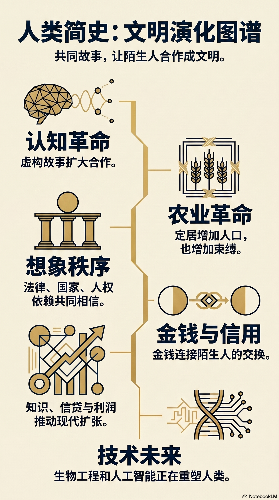
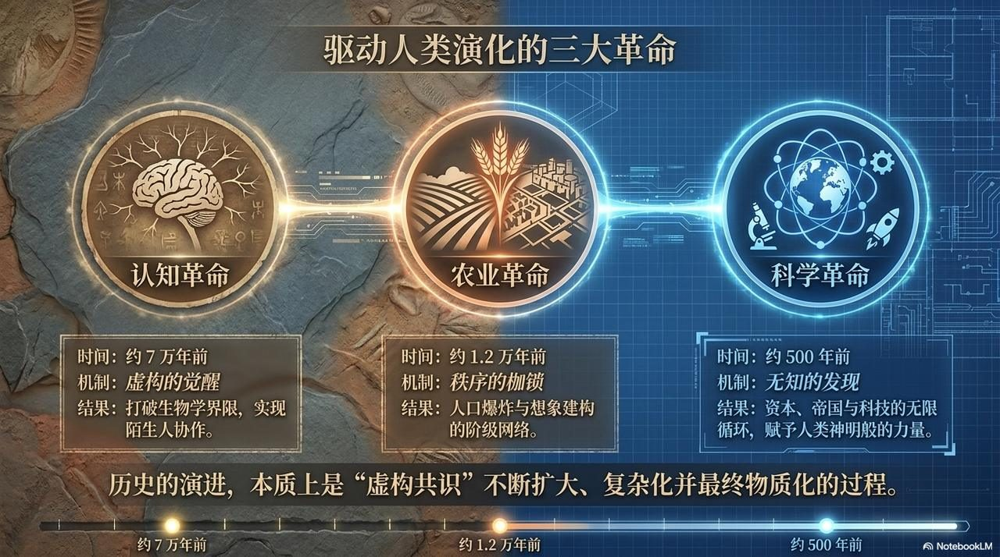
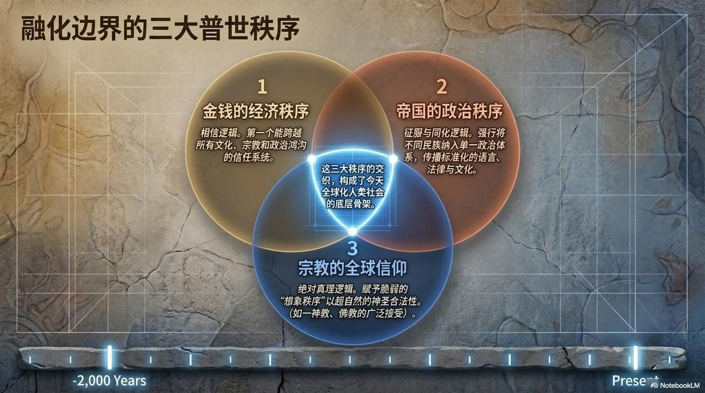
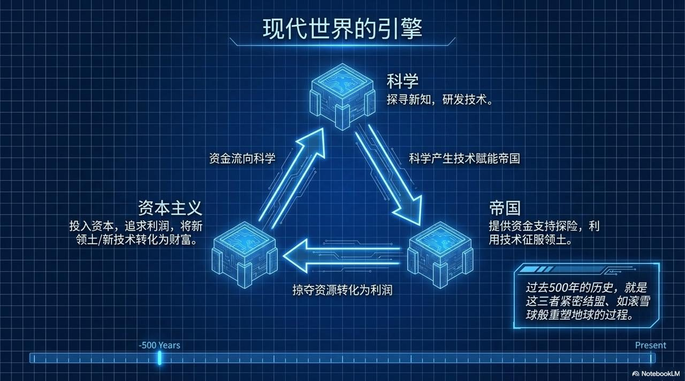
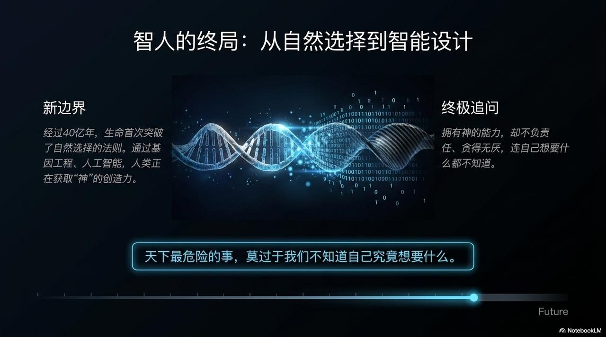

# NotebookLM Workflow

[English](./README.md) | 简体中文

面向 Hermes / Codex 类 AI Agent 的 Google NotebookLM 自动化工作流技能库、提示词模板与端到端实测 Demo 集合。

## 概述

本仓库没有把流程写成单个大脚本，而是将 NotebookLM 自动化拆分为一套可组合的 9 个 Skill（5 个顶层 skill + [`skills/notebooklm/`](./skills/notebooklm/SKILL.md) 下的 4 个专项 sub-skill）。Agent 会按用户需求在“来源准备 → NotebookLM CLI 操作 → 基于原书的 PPT 抽取与事实核查 → Studio 高质量提示词 → 质量检查 → Google Drive 交付”之间自动串联。

## 包含的 Skills

| 层级 | Skill 目录 | 核心职责 |
|---|---|---|
| 核心 CLI / API | [`skills/notebooklm/`](./skills/notebooklm/SKILL.md) | 认证管理（`notebooklm-py==0.3.4`）、多 Profile 切换、创建/列出 Notebook、上传来源并等待索引、生成并下载 Studio 产物与状态排查。附带 [`SECURITY_AUDIT.md`](./skills/notebooklm/SECURITY_AUDIT.md) 与 [`import_browser_cookies.py`](./skills/notebooklm/import_browser_cookies.py)。 |
| 读书分享 PPT 流水线 | [`skills/notebooklm/notebooklm-book-ppt-workflow/`](./skills/notebooklm/notebooklm-book-ppt-workflow/SKILL.md) | 严格基于 NotebookLM 来源抽取书籍结构、核心观点、案例、时间线、人物、概念、引语与误区，先做事实核查再生成讲稿与幻灯片。 |
| Studio 提示词工程 | [`skills/notebooklm/notebooklm-studio-quality-prompts/`](./skills/notebooklm/notebooklm-studio-quality-prompts/SKILL.md) | 针对 Slide Deck（简洁版 / 详细版）、Study Guide、Mind Map、Infographic、Data Table、Quiz、Flashcards、Audio 与 Video 的专用高质量 prompt 模板。 |
| 高密度幻灯片与 QA | [`skills/notebooklm/notebooklm-rich-slide-decks/`](./skills/notebooklm/notebooklm-rich-slide-decks/SKILL.md) | 明确简洁版（10–14 页）与详细版（18–24 页）信息密度目标、版式多样性要求，并配合外部 PowerPoint 工具 / `python-pptx` 完成 `.pptx` 压缩包与视觉 QA。 |
| Google Drive 交付 | [`skills/notebooklm/notebooklm-artifacts-to-drive/`](./skills/notebooklm/notebooklm-artifacts-to-drive/SKILL.md) | 通过 `gws` 将原始全质量产物上传到 Google Drive 的 `NotebookLM/<notebook name>/` 并生成分享链接，避免将大体积二进制文件提交进 git。 |
| 博客批量导入 | [`skills/blog-2-notebooklm/`](./skills/blog-2-notebooklm/SKILL.md) | 解析官方 sitemap（`collect_sitemap_urls.py`）或专题页面，逐篇上传独立 URL 来源，超限自动拆建续接 notebook，并为来源名称统一加注 `YYYY-MM-DD` 日期前缀。 |
| 书籍批量上传 | [`skills/upload-books-to-notebooklm/`](./skills/upload-books-to-notebooklm/SKILL.md) | 扫描本地 `.pdf`/`.txt`/`.md`/`.docx`（`upload_books_to_notebooklm.py`），清洗生成标准 `《书名》` 标题，自动合并多卷本系列并等待来源全部 `ready`。 |
| EPUB 转 PDF | [`skills/epub-2-pdf/`](./skills/epub-2-pdf/SKILL.md) | 生成带安全引号的 Calibre `ebook-convert` 命令（`build_ebook_convert_cmd.py`），支持 `source`/`visible`/`detailed`/`medium`/`concise` 五档目录深度、A4 排版、页码与中文字体。 |
| 合规图书 CLI 辅助 | [`skills/zlibrary-cli/`](./skills/zlibrary-cli/SKILL.md) | `heartleo/zlib` 的安装、配置与故障排查，包含面向非 TTY 环境的 [`noninteractive_download.go`](./skills/zlibrary-cli/scripts/noninteractive_download.go) 与显式多账号切换脚本 [`zlib_account.py`](./skills/zlibrary-cli/scripts/zlib_account.py)。 |

### 典型串联路由

- **本地书籍导入 NotebookLM**：`upload-books-to-notebooklm` -> `notebooklm`
- **EPUB 先转 PDF 再上传**：`epub-2-pdf` -> `upload-books-to-notebooklm` -> `notebooklm`
- **读书分享 PPT 全流程**：`notebooklm-book-ppt-workflow` -> `notebooklm` -> `notebooklm-rich-slide-decks` -> `notebooklm-artifacts-to-drive`
- **生成全套 Studio 产物**：`notebooklm-studio-quality-prompts` -> `notebooklm` -> `notebooklm-artifacts-to-drive`
- **博客/文档站点归档**：`blog-2-notebooklm` -> `notebooklm`

## 前置依赖与认证

建议先配置基础工具，再按需安装对应工作流依赖。

### 基础与核心工具

| 工具 | 用途 | 安装 / 配置 |
|---|---|---|
| `python3` 与 `uv` | 运行辅助脚本、校验器及隔离依赖（如 `pyyaml`、`pypdf`） | 系统自带 `python3`；`brew install uv` |
| `rsync` | 安装与同步 skill 目录 | macOS / Linux 预装 |
| `notebooklm`（`notebooklm-py`） | 所有 NotebookLM 操作（已审计版本 `0.3.4`，详见 [`SECURITY_AUDIT.md`](./skills/notebooklm/SECURITY_AUDIT.md)） | `pip install notebooklm-py` |
| Playwright / Chromium | `notebooklm-py` 登录与 Google 会话捕获 | `python3 -m playwright install chromium` |
| `gws` | Google Drive 上传与分享链接生成（`notebooklm-artifacts-to-drive`） | 安装 Google Workspace CLI 后运行 `gws auth login --services drive` |

### 按需工具

| 工具 | 用途 | 安装 / 配置 |
|---|---|---|
| `python-pptx`、`unzip`、`file` | 重建、校验 `.pptx` 压缩包与文件类型 | `pip install python-pptx`（配合系统 `unzip` / `file`） |
| Calibre（`ebook-convert`）与 `pypdf` | `epub-2-pdf` 格式转换与 PDF 页数/书签验证 | 安装 Calibre（macOS 默认路径 `/Applications/calibre.app/Contents/MacOS/ebook-convert`）；`uv run --with pypdf python ...` |
| `zlib` 与 Go 1.25+ | `zlibrary-cli`（仅用于公版、开源协议、个人已购或获授权图书） | `brew install heartleo/tap/zlib && zlib login`；非交互回退需 `brew install go` |

### 认证与就绪检查

只需执行当前工作流对应的检查命令：

```bash
export NOTEBOOKLM_HOME="$HOME/.notebooklm/profiles/default"  # 如使用独立 Profile 请按实际路径调整
notebooklm auth check --test
notebooklm list --json
gws auth status                                              # 需要 Google Drive 交付时检查
```

> **安全边界**：切勿将 `storage_state.json`、浏览器 cookie、OAuth token、Z-Library 会话、受版权保护的原始书籍或全质量大体积二进制提交到 git。`zlibrary-cli` 仅可用于公版、开放许可、自购或合法授权书籍，不得用于绕过验证码、访问控制或下载配额。

## 快速开始与工作流

### 1. 安装到 Hermes Skills 目录

完整复制 `skills/` 目录以保留 `references/`、`scripts/` 与 `agents/` 文件：

```bash
git clone https://github.com/xdlkc/notebooklm-workflow.git
cd notebooklm-workflow
mkdir -p "$HOME/.hermes/skills"
rsync -a --delete \
  --exclude '__pycache__/' --exclude '*.pyc' --exclude '.DS_Store' \
  "skills/" "$HOME/.hermes/skills/"
```

如需安装到具名 Profile，将目标路径替换为 `"$HOME/.hermes/profiles/<profile>/skills/"`。安装或更新后请重启一个新 Hermes 会话以刷新 skill 索引。

当本地 Hermes skills 更新后，同步回本仓库副本：

```bash
LOCAL_SKILLS="$HOME/.hermes/skills"
for s in notebooklm blog-2-notebooklm upload-books-to-notebooklm epub-2-pdf zlibrary-cli; do
  rsync -a --delete --exclude '__pycache__/' --exclude '*.pyc' --exclude '.DS_Store' \
    "$LOCAL_SKILLS/$s/" "skills/$s/"
done
git diff --stat
```

### 2. 标准执行链路

1. **来源准备**：EPUB 转 PDF（`epub-2-pdf`）、博客 URL 抓取（`blog-2-notebooklm`）或本地书籍批处理分组（`upload-books-to-notebooklm`）。
2. **创建或复用 Notebook**：使用显式 `-n <notebook-uuid>` 参数上传来源（防止多 Agent 并发冲突），并等待全部 source 状态变为 `ready`。
3. **生成 Studio 产物**：应用 `notebooklm-studio-quality-prompts` 为 PPT、学习指南、思维导图、信息图、数据表、测验、闪卡、音频与视频定制提示词，同时保存生成 JSON 与 artifact ID。
4. **下载与质量闸门（QA）**：核查来源依据、`.pptx` 包完整性（`unzip -t`）、中文渲染是否乱码或溢出，以及音视频时长与编码。其中读书分享 PPT 流程会保留 17 份过程审计文件（`00_source_check.md` 至 `16_ppt_visual_qa.md`）。
5. **交付与归档**：全质量原始文件上传 Google Drive（`NotebookLM/<notebook name>/`）；如需沉淀公开 demo，只提交 prompt 日志、manifest 清单和压缩预览副本。

### 3. 校验 Skill 格式

```bash
SKILL_VALIDATOR=${SKILL_VALIDATOR:-$HOME/.hermes/skills/skill-creator/scripts/quick_validate.py}
uv run --with pyyaml python "$SKILL_VALIDATOR" skills/notebooklm
```

## Demo 示例与详解文档

### 实测参考 Demo

- **《人类简史》Demo（[`demos/sapiens/`](./demos/sapiens/README.md)）**：完整最佳实践样本，包含 CLI 复现脚本、8 份提示词文件（`prompts/`）、Drive 产物索引（[`drive_outputs/README.md`](./demos/sapiens/drive_outputs/README.md)）、压缩版 PPTX/PDF/MP4 预览副本（[`compressed_outputs/README.md`](./demos/sapiens/compressed_outputs/README.md)）与 SVG 版式示例。
- **《罪与罚》实测 Demo（[`demos/zuiyufa/`](./demos/zuiyufa/README.md)）**：文学作品端到端实测包，收录结构化 NotebookLM 问答摘录（`notebooklm_answers/`）、QA 失败与通过的信息图对比（`review_outputs/`）、20 页 PPT 预览（`ppt_previews/`）以及 [`demo_manifest.json`](./demos/zuiyufa/demo_manifest.json)。



| 封面 | 三次革命 | 小麦陷阱 |
|---|---|---|
|  |  |  |
| 普世秩序 | 现代引擎 | 未来基因 |
|  |  |  |

### 深度解读文章

- [`docs/notebooklm-workflow-article.md`](./docs/notebooklm-workflow-article.md) — 图解 9 个 skill 的接力机制、产物矩阵与 Remotion 短视频草稿（`docs/assets/notebooklm-workflow/`）。
- [`docs/ai-book-attendant-notebooklm-workflow.md`](./docs/ai-book-attendant-notebooklm-workflow.md) — “AI 书童”实践复盘：记录《罪与罚》端到端跑通全流程的踩坑与质量闸门设计（`docs/assets/ai-book-attendant/`）。

## 仓库目录结构

```text
notebooklm-workflow/
├── README.md
├── README.zh-CN.md
├── demos/
│   ├── sapiens/                         # 《人类简史》最佳实践 Demo（提示词、压缩预览、Drive 链接）
│   └── zuiyufa/                         # 《罪与罚》端到端 QA 对比与产物清单 Demo
├── docs/
│   ├── ai-book-attendant-notebooklm-workflow.md
│   ├── notebooklm-workflow-article.md
│   └── assets/                          # 架构图、插画、PPT 预览图与 Remotion 草稿
└── skills/
    ├── blog-2-notebooklm/               # 博客 / Sitemap URL 批量导入
    ├── epub-2-pdf/                      # Calibre EPUB 转 PDF 命令生成器
    ├── notebooklm/                      # 核心 NotebookLM skill + SECURITY_AUDIT.md + cookie 转换脚本
    │   ├── notebooklm-artifacts-to-drive/
    │   ├── notebooklm-book-ppt-workflow/
    │   ├── notebooklm-rich-slide-decks/
    │   └── notebooklm-studio-quality-prompts/
    ├── upload-books-to-notebooklm/      # 本地书籍自动分组与批量上传
    └── zlibrary-cli/                    # heartleo/zlib 辅助脚本与非交互下载回退
```
